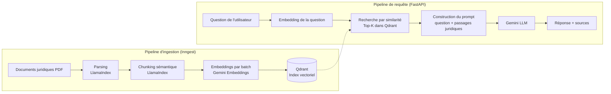

# Production-Ready RAG System : Documents juridiques

Système de Retrieval-Augmented Generation (RAG) conçu pour interroger des documents juridiques en langage naturel, avec des réponses contextualisées, traçables et fondées sur les sources.

## Table des matières

1. [Contexte et problématique](#contexte-et-problématique)
2. [Fonctionnalités](#fonctionnalités)
3. [Architecture](#architecture)
4. [Stack technique](#stack-technique)
5. [Choix orientés production](#choix-orientés-production)
6. [Le pipeline en détail](#le-pipeline-en-détail)
7. [Structure du projet](#structure-du-projet)
8. [Installation et lancement](#installation-et-lancement)
9. [Utilisation de l'API](#utilisation-de-lapi)
10. [Spécificités du domaine juridique](#spécificités-du-domaine-juridique)

---

## Contexte et problématique

Les documents juridiques (lois, décrets, contrats, jurisprudence, circulaires) sont longs, denses et fortement structurés (articles, alinéas, renvois). Retrouver une information précise par recherche par mots-clés est lent et peu fiable.

Un LLM seul n'est pas adapté à ce contexte : il peut halluciner un article de loi, citer une source inexistante ou répondre à partir de connaissances obsolètes. En droit, une réponse approximative est une réponse risquée.

Ce projet répond à ce problème en ancrant chaque réponse du LLM dans les documents réellement indexés :

- le LLM ne répond qu'à partir des passages juridiques retrouvés par la recherche vectorielle ;
- chaque réponse peut être rattachée à ses sources ;
- la base de connaissances peut être mise à jour sans réentraîner de modèle.

---

## Fonctionnalités

- Ingestion de documents juridiques (PDF) avec parsing automatisé
- Chunking sémantique : découpage par unités de sens plutôt que par taille fixe, pour préserver la cohérence des articles et des clauses
- Vectorisation par batch avec Google Gemini Embeddings
- Indexation vectorielle persistante sous Qdrant
- Recherche sémantique des passages les plus pertinents
- Génération de réponses contextuelles via Gemini LLM, à partir des passages retrouvés
- Orchestration fiable des workflows avec Inngest (exécution par étapes, reprises automatiques)
- API REST exposée avec FastAPI

---

## Architecture

Le système sépare deux flux : l'ingestion (hors ligne, coûteuse) et l'interrogation (en ligne, rapide).



---

## Stack technique

| Couche | Technologie | Rôle |
|---|---|---|
| API | FastAPI | Exposition des endpoints d'ingestion et de requête |
| Orchestration | Inngest | Workflows événementiels, exécution par étapes, retries |
| Parsing et chunking | LlamaIndex | Lecture des documents et découpage sémantique |
| Embeddings | Google Gemini Embeddings | Vectorisation des chunks et des questions |
| Base vectorielle | Qdrant | Stockage et recherche par similarité |
| Génération | Google Gemini LLM | Rédaction de la réponse à partir du contexte |
| Langage | Python | |

---

## Choix orientés production

La plupart des projets RAG disponibles en ligne sont des démonstrations : un notebook, un index en mémoire, aucune gestion d'erreur. Ce projet adopte des choix d'architecture pensés pour un usage réel.

**Orchestration durable avec Inngest.** Le pipeline d'ingestion est découpé en étapes indépendantes (parsing, chunking, embedding, indexation). Si une étape échoue (quota API, timeout réseau), Inngest relance uniquement cette étape, sans repartir de zéro et sans perdre le travail déjà effectué.

**Traitement par batch.** Les embeddings sont générés par lots et non chunk par chunk. Cela réduit le nombre d'appels API, le temps d'ingestion et les coûts, et limite les risques de dépassement de quota.

**Persistance avec Qdrant.** Contrairement à un index en mémoire qui disparaît au redémarrage, Qdrant fournit une base vectorielle dédiée et persistante, capable de monter en charge, avec filtrage par métadonnées.

**Séparation des responsabilités.** Ingestion et interrogation sont deux flux distincts : l'indexation de gros volumes de documents n'impacte pas la latence des requêtes utilisateur.

**API découplée et typée.** FastAPI apporte la validation des entrées et sorties, la documentation OpenAPI automatique (`/docs`) et un serveur asynchrone performant.

**Configuration externalisée.** Aucune clé ni paramètre sensible dans le code : tout passe par des variables d'environnement (fichier `.env`, non versionné).

<!-- A ADAPTER : si le dépôt contient aussi Docker / docker-compose, des tests, un CI GitHub Actions, du logging structuré ou un système d'évaluation, les ajouter ici. Supprimer ce qui n'existe pas. -->

---

## Le pipeline en détail

### 1. Parsing

Les documents juridiques sont chargés et convertis en texte exploitable avec LlamaIndex, en conservant les métadonnées utiles (nom du fichier, page).

### 2. Chunking sémantique

Plutôt qu'un découpage tous les N caractères, qui coupe souvent un article en plein milieu, le chunking sémantique regroupe les phrases selon leur proximité de sens. Chaque chunk reste autonome et cohérent, ce qui améliore directement la qualité de la recherche.

### 3. Vectorisation par batch

Chaque chunk est transformé en vecteur avec Gemini Embeddings, par lots, pour optimiser les performances et les coûts.

### 4. Indexation dans Qdrant

Les vecteurs et leurs métadonnées sont stockés dans une collection Qdrant, prête pour la recherche par similarité.

### 5. Recherche

À la réception d'une question, celle-ci est vectorisée avec le même modèle d'embedding, puis les K passages les plus proches sont récupérés dans Qdrant.

### 6. Génération

Les passages retrouvés sont injectés dans le prompt envoyé à Gemini LLM, qui rédige une réponse uniquement à partir de ce contexte. Si l'information n'est pas présente dans les documents, le modèle doit l'indiquer plutôt que d'inventer.

---

## Structure du projet

<!-- A REMPLACER par l'arborescence réelle du dépôt (commande : tree -I ".venv|__pycache__|.git"). L'exemple ci-dessous est indicatif. -->

```text
Production_Ready_RAG_System/
├── main.py                # Application FastAPI + enregistrement des fonctions Inngest
├── ...                    # Modules d'ingestion, de recherche et de génération
├── requirements.txt       # Dépendances Python (ou pyproject.toml)
├── .env.example           # Modèle de variables d'environnement
└── README.md
```

---

## Installation et lancement

### Prérequis

- Python 3.10+
- Docker (pour Qdrant)
- Node.js (pour le serveur de développement Inngest)
- Une clé API Google Gemini ([Google AI Studio](https://aistudio.google.com/))

### 1. Cloner le dépôt

```bash
git clone https://github.com/Aiden-Domochevski/Production_Ready_RAG_System.git
cd Production_Ready_RAG_System
```

### 2. Créer l'environnement virtuel et installer les dépendances

```bash
python -m venv .venv
source .venv/bin/activate        # Windows : .venv\Scripts\activate
pip install -r requirements.txt
```

### 3. Configurer les variables d'environnement

```bash
cp .env.example .env
```

Puis renseigner le fichier `.env` :

```env
GEMINI_API_KEY=votre_cle_api
QDRANT_URL=http://localhost:6333
```

<!-- A VERIFIER : noms exacts des variables dans le code. -->

### 4. Lancer Qdrant

```bash
docker run -p 6333:6333 -v $(pwd)/qdrant_storage:/qdrant/storage qdrant/qdrant
```

### 5. Lancer l'API FastAPI

```bash
uvicorn main:app --reload --port 8000
```

### 6. Lancer le serveur de développement Inngest

```bash
npx inngest-cli@latest dev -u http://127.0.0.1:8000/api/inngest
```

L'interface Inngest est alors disponible sur `http://localhost:8288`, où l'on peut suivre l'exécution de chaque étape du pipeline.

<!-- A ADAPTER : chemins (main:app, /api/inngest) selon le code réel. -->

---

## Utilisation de l'API

La documentation interactive (Swagger) est disponible sur `http://localhost:8000/docs`.

<!-- A ADAPTER : remplacer par les vrais endpoints et formats de payload. Exemple indicatif ci-dessous. -->

Ingérer un document :

```bash
curl -X POST http://localhost:8000/ingest \
  -F "file=@code_des_obligations_et_contrats.pdf"
```

Poser une question :

```bash
curl -X POST http://localhost:8000/query \
  -H "Content-Type: application/json" \
  -d '{"question": "Quelles sont les conditions de validité d'\''un contrat ?"}'
```

Exemple de réponse :

```json
{
  "answer": "Selon les dispositions retrouvées, un contrat est valide lorsque ...",
  "sources": [
    { "document": "code_des_obligations_et_contrats.pdf", "page": 12 }
  ]
}
```

---

## Spécificités du domaine juridique

| Enjeu | Réponse apportée |
|---|---|
| Aucune tolérance à l'hallucination | Le LLM est contraint de répondre à partir des passages retrouvés uniquement |
| Traçabilité | Chaque réponse est associée aux documents sources dont elle provient |
| Structure hiérarchique (articles, alinéas, renvois) | Chunking sémantique pour préserver l'unité de sens des dispositions |
| Vocabulaire technique | Embeddings multilingues capables de capter la sémantique du langage juridique |
| Évolution des textes | Réindexation possible sans réentraînement du modèle |

Avertissement : ce système est un outil d'aide à la recherche documentaire. Il ne constitue pas un conseil juridique et ne remplace pas l'avis d'un professionnel du droit. Les réponses doivent toujours être vérifiées dans les textes sources.